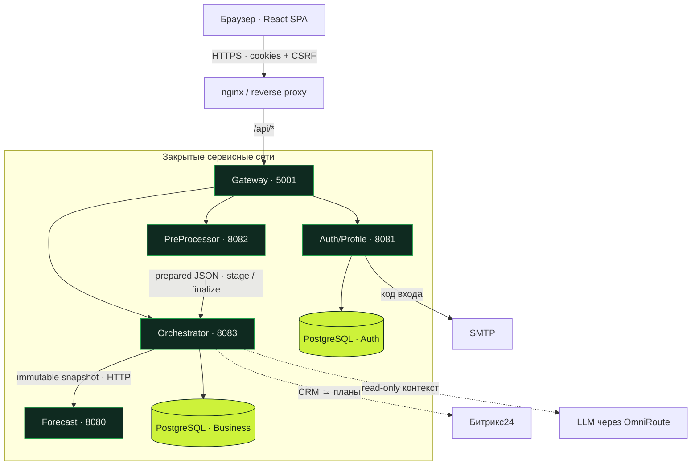
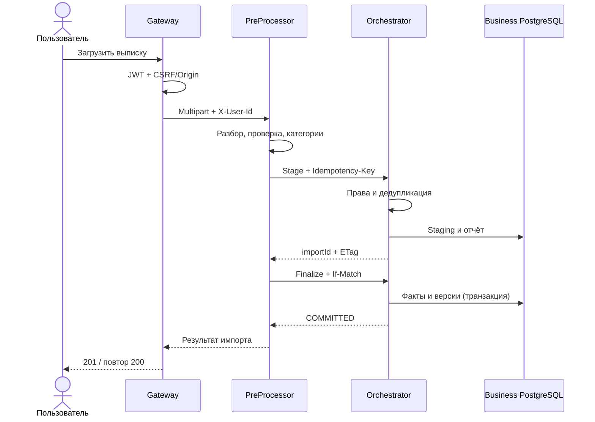
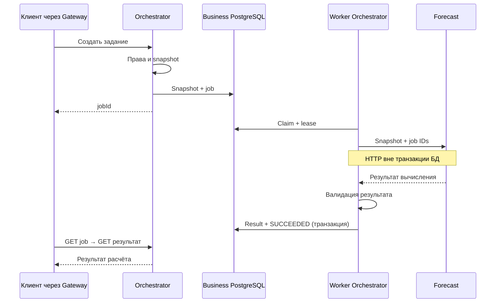
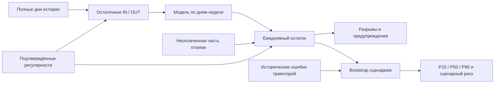

<div align="center">


# ПрогноCIк · Backend

**Финансовое прогнозирование для малого бизнеса**<br>
Хакатон «Осень 2026» · кейс Банка Центр-инвест · Digital Hustle

Выписки → история → планы и регулярности → прогноз на 30 дней → риски и проверка качества

[](https://github.com/Digital-Hustle/hack-2026-back/actions/workflows/ci-build.yml)


[Фронтенд](https://github.com/Digital-Hustle/prognocik-frontend) ·
[Быстрый старт](#быстрый-старт) · [Архитектура](#архитектура) ·
[Модель прогноза](#как-строится-прогноз) · [API](#api-и-контракты) ·
[Документация](#навигация-по-документации)

</div>

---

## Что это

Предпринимателю важно знать, **хватит ли денег на ближайший месяц**, когда возможен кассовый разрыв
и какие платежи влияют на остаток. ПрогноCIк объединяет банковскую историю, будущие поступления,
счета, налоги и зарплаты, строит ежедневный прогноз и проверяет его на прошлых периодах.

Этот репозиторий — **пять Java-сервисов и конфигурация их совместного запуска**.
Здесь находятся финансовые данные, категоризация, расчёт прогноза, оценка риска и контроль доступа.
[Фронтенд](https://github.com/Digital-Hustle/prognocik-frontend) обращается к ним через Gateway.

В основе расчёта — воспроизводимые статистические модели. LLM подключается отдельно как
**помощник для объяснения уже имеющихся данных**, с проверяемыми источниками и без права менять их.

## Возможности

| Область | Что реализовано |
| --- | --- |
| **Вход и профиль** | Email-код через SMTP, сессии, JWT RS256, refresh/logout, отзыв сессий, профиль с версией. |
| **Компании и счета** | Участники с ролями OWNER / ACCOUNTANT / VIEWER, RUB-счета, архивирование, проверка ИНН/КПП. |
| **История операций** | CSV / XLSX / XLS, категоризация правилами, отчёт об ошибках, дедупликация, ручные факты и исправления. |
| **Полнота данных** | Дневная история, подтверждённые нулевые дни, пропуски, балансные якоря и проверка согласованности остатков. |
| **Планы и регулярности** | Будущие платежи, частичные оплаты, распределения фактов на планы, поиск и подтверждение регулярных потоков. |
| **Прогноз и риск** | Остаток на каждый из 30 дней, эпизоды дефицита, сценарные интервалы и вероятность при достаточной истории. |
| **Качество модели** | Скользящий бэктест, метрики ошибок и разрывов, сравнение моделей и окон, trace расчёта и экспорт. |
| **Управление платежами** | Календарь обязательств, справочник налоговых сроков 2026, сотрудники и регулярная зарплата, план-факт. |
| **«Что если»** | Серверный пересчёт изменений поверх готового прогноза и оценка допустимой суммы платежа. |
| **Интеграции** | Синхронизация сделок и счетов Битрикс24; демонстрационная загрузка документов 1С. |
| **AI-ассистент** | Read-only ответы по выбранному счёту, данным прогноза, рискам, категориям и качеству истории. |

Наличие реализации и тестов не подтверждает доступность конкретной функции в текущем развёртывании.
[Границы возможностей и допущения](#границы-возможностей-и-допущения) приведены отдельно.

## Быстрый старт

### Полный стек через Docker Compose

Нужны **JDK 21**, Docker с Compose v2 и доступ к SMTP для настоящего входа.
Gradle Wrapper включён в репозиторий; первая сборка загружает зависимости.

```bash
git clone https://github.com/Digital-Hustle/hack-2026-back.git
cd hack-2026-back

# Образы используют готовые JAR: сначала собираем все пять сервисов.
bash gradlew assemble --no-daemon

cp .env.full.example .env
# Заполните .env: пароли двух БД, SMTP, ключи JWT, HMAC и HTTPS-origin фронтенда.

docker compose --env-file .env -f compose.full.yaml config --quiet
docker compose --env-file .env -f compose.full.yaml up -d --build
docker compose --env-file .env -f compose.full.yaml ps
```

На Windows сборка: `.\gradlew.bat assemble --no-daemon`; копирование шаблона:
`Copy-Item .env.full.example .env`. Остальные команды Compose те же.

Ключи JWT — согласованная RSA-пара: приватный PKCS#8 DER и публичный X.509 DER в base64.
HMAC — как минимум 32 случайных байта в base64. Команды генерации описаны в
[настройке Auth/Profile](docs/AUTH_PROFILE_RUNTIME.md#конфигурация).
Секреты хранятся в локальном `.env`, который исключён из Git.

**Gateway доступен на `http://127.0.0.1:5001`.** Остальные сервисы и обе БД не публикуют порты
на хост. Перед Gateway нужен HTTPS reverse proxy: авторизация использует Secure/HttpOnly cookies.
Публичный origin фронтенда должен совпадать с `AUTH_ALLOWED_ORIGINS`.
Как подключить nginx фронтенда к сети бэкенда — в
[README фронтенда](https://github.com/Digital-Hustle/prognocik-frontend#быстрый-старт).

```bash
# Health Gateway; не заменяет проверку БД, SMTP и полного пользовательского сценария.
curl --fail http://127.0.0.1:5001/actuator/health

# Пример диагностики одного сервиса.
docker compose --env-file .env -f compose.full.yaml logs --tail=100 orchestrator
```

### Конфигурация

| Переменные | Назначение |
| --- | --- |
| `AUTH_DB_PASSWORD`, `ORCHESTRATOR_DB_PASSWORD` | Пароли двух независимых PostgreSQL в Compose. |
| `AUTH_ALLOWED_ORIGINS` | Разрешённый HTTPS-origin браузера; используется Auth/Profile и Gateway. |
| `AUTH_MAIL_FROM`, `SMTP_*` | Отправитель и параметры реальной доставки кода. |
| `AUTH_JWT_PRIVATE_KEY`, `AUTH_JWT_PUBLIC_KEY`, `AUTH_OTP_HMAC_SECRET` | Обязательные ключи для JWT, OTP и CSRF. |
| `AUTH_JWT_ISSUER`, `AUTH_JWT_AUDIENCE`, `AUTH_JWT_KEY_ID` | Согласованные параметры выпуска и проверки JWT. |
| `OMNIROUTE_API_KEY`, `OMNIROUTE_BASE_URL`, `OMNIROUTE_MODEL` | Провайдер AI-ассистента; ключ нужен для его запросов. |

Источники значений — [Compose](compose.full.yaml) и `application.yml` / `application.yaml` каждого сервиса.
Compose явно передаёт контейнерам перечисленные в нём переменные: произвольное значение в `.env`
не становится настройкой приложения автоматически.

### Разработка без Compose

Сервисы можно запускать отдельно; Auth/Profile и Orchestrator нужны собственные PostgreSQL.
Для Auth/Profile есть [отдельный Compose](compose.auth-profile.yaml) и
[шаблон окружения](.env.auth-profile.example).

```bash
# Пример: отдельный процесс Forecast.
bash gradlew :services:forecast:bootRun

# Пример: Orchestrator в другом терминале, после настройки его БД.
# При запуске вне Docker переопределите адрес Forecast на loopback.
ORCHESTRATOR_FORECAST_URL=http://127.0.0.1:8080 \
  bash gradlew :services:orchestrator:bootRun
```

Spring Boot при `bootRun` не загружает `.env` сам: переменные нужно передать процессу.
Порты и health endpoints перечислены ниже; подробные параметры — в документации сервисов.

## Архитектура

### Пять сервисов, две базы данных



| Сервис | Ответственность | Хранение | Health при прямом внутреннем доступе |
| --- | --- | --- | --- |
| **[Auth/Profile](docs/AUTH_PROFILE_RUNTIME.md)** | Пользователь, профиль, email OTP, сессии, JWT и CSRF. | Собственная PostgreSQL; Liquibase + jOOQ. | `:8081/actuator/health` |
| **[Gateway](services/gateway-server/README.md)** | Маршруты, JWT, CSRF/Origin, очистка входящих заголовков и доверенный контекст. | Stateless. | `:5001/actuator/health` |
| **[PreProcessor](services/preprocessor/README.md)** | Разбор CSV/Excel, валидация, нормализация, правила категорий и координация публичного импорта. | Stateless; историю хранит Orchestrator. | `:8082/health` |
| **[Orchestrator](services/orchestrator/README.md)** | Компании, доступ, история, планы, snapshots, jobs, результаты, сценарии и интеграции. | Собственная PostgreSQL; Liquibase + Spring JDBC. | `:8083/health` |
| **[Forecast](services/forecast/README.md)** | Прогноз, поиск регулярностей, сценарный риск и бэктест по входному snapshot. | Stateless; без своей БД и внешних HTTP-вызовов. | `:8080/health` |

В Compose nginx/reverse proxy размещается отдельно. Встроенный воркер и планировщик автообновления —
части Orchestrator, отдельного сервиса очередей нет. Forecast не получает доступ к бизнес-БД.

### Как выписка становится историей

Публичная загрузка `POST /api/v1/preprocessor/companies/{companyId}/imports`
выполняет подготовку и сохранение за один клиентский запрос.
Внутренний `prepare` возвращает проверенный JSON и сам по себе ничего не сохраняет.



Режимы `ATOMIC` / `SKIP_INVALID` и `UNKNOWN` / `CONFIRMED_COMPLETE` управляют обработкой ошибок
и полнотой периода. При неоднозначном сбое finalize PreProcessor проверяет состояние импорта.
Повтор не должен создавать вторые факты; автоматическая отмена уже завершившейся операции не выполняется.

Массовые CSV-импорты справочника компаний и операций — **отдельные endpoints Orchestrator**.
Они не проходят тот же маршрут публичной загрузки одной выписки.
Форматы и примеры — в [гайде API](docs/FRONTEND_API_GUIDE.md).

### Как выполняется расчёт



Так выполняются задания `FORECAST`, `BACKTEST` и `DETECT_RECURRING`.
Очередь хранится в PostgreSQL. Задания проходят `QUEUED → RUNNING → SUCCEEDED / FAILED / CANCELLED`;
временные сетевые ошибки и допустимые 5xx повторяются с backoff. Проверка владельца, попытки и срока
lease защищает сохранение от опоздавшего воркера. Повтор использует тот же snapshot и идентификаторы.

Изменения финансовых входов повышают `dataVersion`. Старый результат определяется как `STALE` при чтении;
планировщик автообновления создаёт обычное задание для обновлённых данных. Это полный расчёт по новому
snapshot, а не инкрементальная ML-модель.

## Как строится прогноз

На входе — **один RUB-счёт**, дата среза `T`, стартовый остаток, история за 8 / 10 / 12 недель,
подтверждённые регулярности и известные планы. Горизонт — **T+1 … T+30**.



```text
B(d) = B(d − 1)
     + остаточное IN(d)  + регулярное IN(d)  + плановое IN(d)
     − остаточное OUT(d) − регулярное OUT(d) − плановое OUT(d)
```

**Двойного учёта быть не должно:** исторические платежи подтверждённой регулярности исключаются
из остаточного потока, а план с явной связью заменяет соответствующую регулярность или baseline.
Оплаченная часть плана повторно в будущее не добавляется.

### Две точечные модели

| Модель | Подход |
| --- | --- |
| `WEEKDAY_MEAN_V1` | Средние остаточные поступления и списания по дням недели; модель по умолчанию. |
| `WEEKDAY_ROBUST_V2` | Ограничение выбросов, сглаживание оценок будних дней и учёт нерабочих праздников в остаточном потоке; включается настройкой. |

Это статистические алгоритмы на Java. Их выбор и параметры описаны в
[`ForecastSettings`](services/orchestrator/src/main/java/ru/cashflow/orchestrator/features/settings/model/ForecastSettings.java)
и [`PointForecastEngine`](services/forecast/src/main/java/ru/cashflow/forecast/features/forecast/application/PointForecastEngine.java).

### Сценарный риск

`HISTORICAL_TRAJECTORY_BOOTSTRAP` использует целые парные 30-дневные траектории ошибок IN/OUT.
По умолчанию строятся 2000 сценариев; требуется минимум 12 зрелых исторических точек оценки.
Из них получаются дневные P10/P50/P90 и доля сценариев с отрицательным остатком в периоде.

При недостатке истории вероятность остаётся **`null`**, а не превращается в 0 %.
`probabilityCalibrated=false`: текущая сценарная оценка не заявляется как калиброванная вероятность.
12 недель для точечного прогноза сами по себе не обеспечивают достаточно истории для риска.

### Проверка качества

Бэктест воспроизводит расчёт на скользящих исторических срезах и отдельно сопоставляет его с фактом.
В отчёте есть ошибки остатка и потоков, метрики обнаружения разрывов, сравнение с наивными baseline
и доступными сочетаниями двух моделей с окнами 8 / 10 / 12 недель.
Выбор кандидата выполняется на ранней части точек оценки, результат проверяется на более позднем holdout.
Это рекомендация из отчёта; основной алгоритм задаётся настройкой счёта.

Принципы и wire-формат — в [README Forecast](services/forecast/README.md) и
[handoff Orchestrator ↔ Forecast](backend-skills/docs/ORCHESTRATOR_FORECAST_HANDOFF.md).

## Данные, версии и безопасность

### Финансовые инварианты

- **Деньги:** Java `BigDecimal`, PostgreSQL `numeric`, на финансовых JSON-границах — десятичные строки.
- **Пропуск ≠ ноль:** `OBSERVED` — полный день с операциями, `ZERO_CONFIRMED` — подтверждённый день без них,
  `MISSING` — недостаточно данных. Через неизвестный период остаток произвольно не протягивается.
- **Факт ≠ план:** операции, ожидаемые платежи и результаты прогноза — разные сущности.
  Частичная оплата учитывается через allocations; просрочка не переносится на завтра автоматически.
- **Остаток EOD:** значение на конец дня, а не сумма остатков всех строк выписки.
- **История изменений:** revisions и `knownAt` позволяют восстановить знания на момент среза.
  Будущие планы и поздние изменения не должны попадать во вход исторического расчёта.

Архивные банковские факты имеют отдельное допущение: импорт назначает им `knownAt` на конец дня
операции через [`ArchiveKnowledge`](services/orchestrator/src/main/java/ru/cashflow/orchestrator/features/ledger/command/ArchiveKnowledge.java).
Так загруженная сегодня история доступна бэктесту прошлых дат. Это реконструкция архива,
а не доказательство фактического времени получения банковских данных.
Массовая выгрузка операций считается полной между первой и последней операцией;
для неполной выписки используйте явный режим `UNKNOWN` обычного импорта.

| Поле | Значение |
| --- | --- |
| `version` | Optimistic locking отдельной сущности; передаётся через `If-Match`. |
| `dataVersion` / `inputDataVersion` | Версия финансовых данных компании / версия входов snapshot. |
| `snapshotId` | Идентификатор сохранённого входного снимка. |
| `fingerprint` | Хеш содержимого snapshot для контроля воспроизводимости и целостности. |
| `knownAt` / `knowledgeCutoff` | Когда данные считаются известными / исключительная граница знания расчёта. |

### Границы доверия

Gateway проверяет JWT и CSRF/Origin, удаляет входящий пользовательский контекст и выставляет
доверенные `X-User-Id` / `X-Auth-Session-Id`. Downstream-сервисы доступны только в закрытых сетях.
Orchestrator в каждом финансовом запросе проверяет членство и роль для компании и принадлежность счёта.

- Токены браузера — Secure/HttpOnly cookies; refresh хранится в хешированном виде и ротируется.
- Повторяемые команды используют `Idempotency-Key`, правки сущностей — `If-Match`.
- Forecast принимает только внутренние запросы; в нём есть CIDR-allowlist и лимиты нагрузки.
- Внутренние `/internal/**`, БД и actuator сервисов не публикуются через Gateway как пользовательский API.
- Секреты, OTP, выписки и финансовые payload не должны попадать в Git и логи.

## API и контракты

| Маршрут / источник | Для чего нужен |
| --- | --- |
| `/api/v1/auth-profile/**` | Вход, профиль и сессии; [OpenAPI 3.1](docs/openapi/auth-profile.yaml), включается в JAR Auth/Profile. |
| `/api/v1/preprocessor/**` | Подготовка и публичная загрузка выписок через Gateway. |
| `/api/v1/orchestrator/**` | Компании, история, планы, интеграции, задания и сохранённые результаты. |
| `/internal/v1/forecast/*` | Внутренние `calculate`, `backtest`, `recurring-detection`; вызываются Orchestrator. |
| [Frontend API guide](docs/FRONTEND_API_GUIDE.md) | Публичные DTO, параметры, сценарии и примеры для браузера. |
| [Маршруты Gateway](services/gateway-server/src/main/resources/application.yml) | Фактически разрешённые методы и пути. |

Gateway содержит совместимые с фронтендом маршруты и преобразования; HTTP-контроллеры сервисов
остаются источником фактического поведения. Ошибки передаются как `application/problem+json`;
точные поля и коды смотрите в документации соответствующего API.

## Структура и стек

```text
.
├─ services/
│  ├─ auth-profile/       пользователи, профиль, OTP, сессии; PostgreSQL + jOOQ
│  ├─ gateway-server/     Spring Cloud Gateway, WebFlux, JWT и CSRF
│  ├─ preprocessor/       CSV/Excel, валидация, категоризация, импорт
│  ├─ orchestrator/       бизнес-данные, snapshot/job pipeline, результаты, интеграции
│  ├─ forecast/           точечные модели, риск, регулярности, бэктест
│  └─ deploy/             общий Dockerfile для готового JAR
├─ docs/                  API, инструкции запуска и зафиксированные проверки
├─ http/                  HTTP-сценарий Auth/Profile
├─ tools/one-c-mock/       отдельный демонстрационный стенд 1С
├─ backend-skills/        архитектурные соглашения и подробный handoff
├─ .github/               CI, выбор затронутых сервисов, публикация отчётов
├─ compose.full.yaml      пять сервисов и две PostgreSQL
└─ .env.full.example      параметры полного стека без секретов
```

**Java 21 · Spring Boot 3.5.x · Gradle Kotlin DSL · PostgreSQL 16 · Liquibase**

Auth/Profile использует jOOQ, MapStruct и Lombok; Orchestrator — Spring JDBC (`JdbcClient`).
Gateway — реактивный Spring Cloud Gateway. Для файлов используются Apache Commons CSV и Apache POI.
Код разделён по feature: HTTP DTO/controller → application → command/query → repository/gateway;
вычислительные сервисы не получают бессмысленный persistence-слой.

Точные версии — в [version catalog](gradle/libs.versions.toml) и `build.gradle.kts` сервисов.
Корневой Wrapper — Gradle 9.2.1; основная проверка всех сервисов выполняется из корня монорепозитория.

## Проверки и CI

```bash
# Все модули: тесты, подключённые проверки качества и сборка.
bash gradlew check build --continue --no-daemon

# Один сервис; замените имя при необходимости.
bash gradlew :services:orchestrator:test :services:orchestrator:build --continue --no-daemon

# Проверка правил выбора сервисов для CI.
python3 -m unittest discover -s .github/scripts/tests -v
```

На Windows используйте `.\gradlew.bat`. Python-проверки выбора сервисов запускайте в Linux/WSL
с доступной командой `python3`: один сценарий проверяет имя файла с переносом строки,
которое Windows не поддерживает.

| Уровень | Что проверяется |
| --- | --- |
| Unit и HTTP | Расчёты, категоризация, валидация, авторизация, ошибки и wire-контракты. |
| PostgreSQL integration | Импорт, дедупликация, версии, исторические срезы, lease/retry и конкурентные изменения. |
| Межсервисная совместимость | `RealForecastCompatibilityTest` запускает настоящий Forecast JAR; Orchestrator тестирует его с embedded PostgreSQL. |
| Архитектура и стиль | ArchUnit; Checkstyle и JaCoCo в сервисах, где они подключены. |

Auth/Profile и Orchestrator поднимают **временный embedded PostgreSQL**, Docker для этих тестов не нужен.
Auth/Profile перед компиляцией генерирует jOOQ по Liquibase-схеме на временной БД.
Запуск PostgreSQL от root требует поддержки user namespaces; для проблемных Windows-путей используйте латинский checkout.
Настройки внешней тестовой БД — в документации сервисов.
`PreprocessorContractTest` дополнительно использует `PREPROCESSOR_SAMPLE_JSON`; без него проверка пропускается.

[Backend CI](.github/workflows/ci-build.yml) работает на PR, push в `main`, `develop`, `feature/**`
и ручном запуске. Общий workflow выбирает затронутые сервисы и проверяет их отдельными matrix jobs.
JUnit публикуется в Checks и Summary; отчёты тестов, Checkstyle и JaCoCo сохраняются как артефакты, когда существуют.
Изменения общих Gradle/CI-файлов запускают все сервисы, `docs/openapi/auth-profile.yaml` — Auth/Profile;
обычные изменения корневого README не требуют пересборки сервисов. Финальный job `verify` проверяет итог.

Локальные отчёты находятся в `services/<service>/build/reports/`.
Моки внешних систем и зелёный CI не подтверждают SMTP-доставку, сетевую изоляцию и все сценарии на сервере.

## Границы возможностей и допущения

| Область | Текущая граница |
| --- | --- |
| Прогноз | Один RUB-счёт за расчёт, горизонт 30 дней. Недостаток истории возвращается явно. |
| Вероятность | Сценарная и некалиброванная; при недостатке зрелой истории оценки нет. |
| «Что если» | Изменяет траекторию готового прогноза; вероятность разрыва заново не оценивается. |
| 1С | Встроенный `OneCDemoService` создаёт планы из фиксированного реестра; подключения к настоящей 1С нет. |
| Битрикс24 | Реальный HTTP-адаптер для сделок/счетов и отдельный demo-режим; нужен разрешённый HTTPS-вебхук. |
| AI | Нужен внешний провайдер. Ассистент читает разрешённые факты, не создаёт платежи и не заменяет численную модель. |
| Налоги и праздники | Справочник налоговых сроков — 2026. Robust-модель содержит календарь 2023–2026; другие годы требуют актуализации переносов. |
| Регулярные графики | `FOLLOWING` переносит на Mon–Fri; полного производственного календаря для этих переносов нет. |
| Банковские интеграции | Загрузка файлов и ручные данные; прямое подключение банка, маркетплейсов и ЭДО не заявлено. |

## Навигация по документации

| Документ | Когда открывать |
| --- | --- |
| [Auth/Profile API](docs/AUTH_PROFILE_API.md) · [Runtime](docs/AUTH_PROFILE_RUNTIME.md) | Вход, cookies/CSRF, SMTP и конфигурация ключей. |
| [Gateway](services/gateway-server/README.md) | Маршруты и граница браузерной аутентификации. |
| [PreProcessor](services/preprocessor/README.md) | Форматы файлов, лимиты, правила валидации и категорий. |
| [Orchestrator](services/orchestrator/README.md) | Бизнес-сущности, версии, snapshots, jobs и интеграции. |
| [Forecast](services/forecast/README.md) | Вычисления, риск, бэктест, внутренний API и ограничения. |
| [Frontend API guide](docs/FRONTEND_API_GUIDE.md) | Основной вход для разработчика клиента. |
| [Сотрудники](docs/EMPLOYEES_API.md) · [Ручные платежи](docs/MANUAL_PAYMENTS_API.md) | Подробные контракты отдельных сценариев. |
| [Архитектурный guide](backend-skills/docs/BACKEND_GUIDE.md) · [Handoff](backend-skills/docs/ORCHESTRATOR_FORECAST_HANDOFF.md) | Границы сервисов, финансовые инварианты и схема обмена. |
| [Правила проекта](AGENTS.md) | С чего начать изменение кода или контракта. |

Старые checkpoint-документы фиксируют состояние на свою дату, а некоторые README сервисов сохраняют
историю поэтапной разработки. При расхождении сверяйте поведение с текущими контроллерами,
конфигурацией и тестами. Этот README описывает состав и реализацию `main`, проверенные 25 октября 2026 года.
