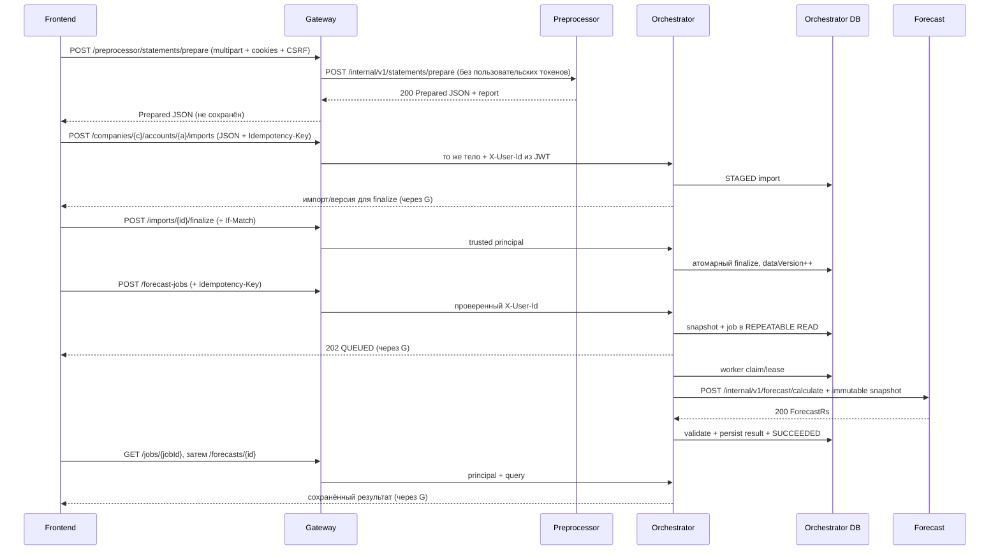

# Межсервисные контракты Cashflow backend

> Состояние **ветки `main` на 24.10.2026**. Эта папка документирует **действующие HTTP-границы** пяти сервисов, wire-форматы, безопасность, ограничения и примеры. Она **не** объявляет draft-методы реализованными и **не** вводит новый gateway/endpoint. Для проверки фактического поведения приоритет имеют код, маршруты и тесты соответствующих сервисов.

## Навигация

| Файл | Что описано |
| --- | --- |
| [topology-and-trust.md](topology-and-trust.md) | Архитектура, доверенные границы, протоколы, cookies/JWT/CSRF, маршрутизация и последовательности |
| [gateway-auth-profile.md](gateway-auth-profile.md) | Gateway ↔ Auth/Profile: OTP, refresh, сессии, профиль, CSRF-проверка |
| [preprocessor-orchestrator.md](preprocessor-orchestrator.md) | **Новый:** синхронный CSV-upload Preprocessor → Orchestrator с recovery, DTO и ограничениями (merged PR #21) |
| [gateway-preprocessor-import.md](gateway-preprocessor-import.md) | Gateway → Preprocessor и **двухэтапная** доставка JSON в Orchestrator, CSV/JSON и finalize |
| [gateway-orchestrator.md](gateway-orchestrator.md) | Gateway → Orchestrator: публичные маршруты, роли, операции, планы, jobs, polling |
| [orchestrator-forecast.md](orchestrator-forecast.md) | Orchestrator → Forecast: три внутренних POST, DTO, snapshots/fingerprint, ответы, риски, backtest |
| [compatibility-and-failures.md](compatibility-and-failures.md) | Матрица ошибок, повторы, идемпотентность, версионирование, тестирование изменения контракта |
| [examples/](examples/) | Запросы `.http`, пример подготовленного JSON и небольшой синтетический CSV |

## Матрица реальных вызовов

| Источник | Получатель | Транспорт / путь | Доступность | Кто владеет состоянием |
| --- | --- | --- | --- | --- |
| Web → **Gateway** | Auth/Profile | `/api/v1/auth-profile/auth/**`, `/profile/me` (путь сохраняется) | Маршруты из `application.yml` | Auth/Profile PostgreSQL |
| **Gateway** | Auth/Profile | Внутренний `GET /api/v1/auth-profile/auth/csrf` для сверки CSRF-привязки | Для защищённых мутаций | Auth/Profile |
| **Preprocessor** | **Orchestrator** | Внутренние `POST /imports` → `POST /finalize` → при неопределённости `GET /imports/{id}` | Реализовано в main; публичный upload **не маршрутизируется Gateway** | Orchestrator PostgreSQL |
| Web → **Gateway** | Preprocessor | `POST /api/v1/preprocessor/statements/prepare` → `POST /internal/v1/statements/prepare` | Работает как подготовка, **не** импорт | Stateless |
| Web → **Gateway** | Orchestrator | `/api/v1/orchestrator/companies/**` с **явным** списком методов и путей | См. [каталог](gateway-orchestrator.md), не произвольный wildcard | Orchestrator PostgreSQL |
| **Orchestrator** | Forecast | `POST /internal/v1/forecast/calculate` | HTTP клиент + worker; вычислитель | Orchestrator сохраняет результат |
| **Orchestrator** | Forecast | `POST /internal/v1/forecast/backtest` | HTTP клиент + worker; вычислитель | Orchestrator сохраняет результат |
| **Orchestrator** | Forecast | `POST /internal/v1/forecast/recurring-detection` | Внутренний HTTP есть; **полный публичный цикл надо проверить/доделать** | Orchestrator сохраняет кандидатов/решения |

**Чего нет:** опубликованного **через Gateway** нового синхронного `POST /api/v1/preprocessor/companies/{companyId}/imports` (хотя прямой Preprocessor → Orchestrator HTTP stage/finalize теперь реализован), прямого `Gateway → Forecast` маршрута, брокера, Config Server, отдельных Org/Planning/Integrations или БД у Gateway/Preprocessor/Forecast. Публичная маршрутизация `POST .../recurring-detection-jobs` **отсутствует в текущем gateway `application.yml`**; не считать её работающей от одного наличия внутреннего Forecast-метода.

## Изменения после создания каталога

- **Merged PR #21:** синхронный upload на Preprocessor `POST /api/v1/preprocessor/companies/{companyId}/imports`, который сам вызывает Orchestrator (stage → finalize → при неоднозначном исходе GET). Его DTO, статусы `201/200`, ограничения 20 MiB / 50 000 строк, идемпотентность и известные проблемы описаны в [preprocessor-orchestrator.md](preprocessor-orchestrator.md).
- **Merged PR #23:** Gateway `OrchestratorCompat` переписывает `/companies/{companyId}/payments|imports?accountId={uuid}` в `/companies/{companyId}/accounts/{uuid}/payments|imports`. Новый upload-путь Preprocessor через Gateway **пока не опубликован**.
- **Compose:** добавлен `compose.full.yaml` с закрытыми сетями. Для синхронного upload Preprocessor нужно отдельно установить `PREPROCESSOR_ORCHESTRATOR_URL=http://orchestrator:8083`, сейчас в compose этого нет.
- Схема ниже описывает **сохранившийся legacy prepare/manual import**, не единственный возможный backend-путь.

## Sequence: подготовка CSV и прогноз

Схема — **последовательность отдельных API-действий**, а не утверждение о готовом автоматическом сквозном frontend-потоке. Обязательны права `CompanyScope`, CSRF и `If-Match` там, где предусмотрено.

## Источники контрактов (главнее пересказа)

- [Auth/Profile OpenAPI 3.1](../docs/openapi/auth-profile.yaml) + [интеграционная инструкция](../docs/AUTH_PROFILE_API.md).
- [Фактические Gateway routes](../services/gateway-server/src/main/resources/application.yml) + [Gateway README](../services/gateway-server/README.md).
- [Preprocessor README](../services/preprocessor/README.md) + [полный синтетический JSON](../services/preprocessor/docs/JSON.md).
- [Orchestrator README](../services/orchestrator/README.md), его контроллеры/тесты и миграции.
- [Orchestrator → Forecast handoff](../backend-skills/docs/ORCHESTRATOR_FORECAST_HANDOFF.md) — wire-поля и инварианты; заголовок handoff по-прежнему draft, готовность сверять с кодом.
- [Forecast README](../services/forecast/README.md), [Forecast HTTP](../services/forecast/http/forecast.http), [расчётная фикстура](../services/forecast/src/test/resources/fixtures/calculate.json), [backtest](../services/forecast/src/test/resources/fixtures/backtest.json), [detection](../services/forecast/src/test/resources/fixtures/recurring-detection.json).

Это **живой индекс**. При изменении публичных путей, HTTP полей, stateless границы, способа передачи principal или форматах DTO обновляйте эту папку вместе с контрактными тестами и API-спецификациями [Zapas](https://github.com/Digital-Hustle/zapas).
