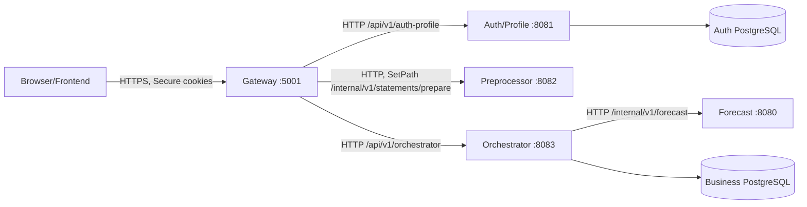

# Топология, транспорт и границы доверия

## Сервисы и сети

Порты — **настройки по умолчанию**, не публичные адреса. Только HTTPS reverse-proxy/Gateway доступен браузеру. Downstream-порты в production должны быть изолированы; `/internal/**` не маршрутизируется извне. В stateless сервисах нет своих БД; Forecast подключается только к Orchestrator как внутренний вычислитель.

| Сервис | Default | Override | Путь |
| --- | --- | --- | --- |
| Gateway | `5001` | `GATEWAY_PORT` | Public `/api/v1/**` по явным predicates |
| Auth/Profile | `8081` | `AUTH_PROFILE_URL` в Gateway | Путь `/api/v1/auth-profile/**` сохраняется без `StripPrefix` |
| Preprocessor | `127.0.0.1:8082` | `PREPROCESSOR_URL`, `PREPROCESSOR_BIND_ADDRESS` | Gateway переписывает **только** prepare на `/internal/v1/statements/prepare` |
| Orchestrator | `127.0.0.1:8083` | `ORCHESTRATOR_URL` | Путь `/api/v1/orchestrator/**` сохраняется |
| Forecast | `127.0.0.1:8080` | `ORCHESTRATOR_FORECAST_URL` | Только `/internal/v1/forecast/{calculate,backtest,recurring-detection}` |

## Аутентификация и trust boundary

1. Auth/Profile выпускает **RS256** access JWT (в HttpOnly Secure cookie `__Host-cashflow-access`) и непрозрачный refresh (`__Secure-cashflow-refresh`). Сами токены **никогда** не возвращаются в JSON и не передаются в Forecast.
2. Gateway валидирует RSA-подпись, `kid`, `iss`, `aud`, `exp/nbf`, UUID `sub/sid`, удаляет внешние `X-User-*`, `X-Auth-*`, `Authorization` и `Cookie`, создаёт ровно один доверенный `X-User-Id` + `X-Auth-Session-Id` (только где применимо). Все заголовки, устанавливаемые клиентом с теми же именами, **не доверены**.
3. Auth/Profile и Orchestrator принимают такой контекст **только** из закрытой Gateway-сети. Orchestrator дополнительно проверяет членство, `CompanyScope`, принадлежность счёта и роль; `company_id` из CSV **не** определяет tenant.
4. Состояние сессии хранится в Auth/Profile. Gateway проверяет подпись и срок, но отзыв сессии для других сервисов **может вступить в силу только после истечения access JWT** (см. ограничения Auth API). Нельзя обещать немедленный глобальный logout.
5. Forecast получает `Idempotency-Key`/job/calculation IDs и **полный бизнес-snapshot**, но не JWT, cookies, произвольные пользовательские auth-заголовки и доступ к Postgres.
6. JWT private key, refresh hash, OTP HMAC и финансовые данные не писать в логи и примеры. Публичный JWT key передаётся Gateway через `GATEWAY_JWT_PUBLIC_KEY` (fallback `AUTH_JWT_PUBLIC_KEY`); `GATEWAY_JWT_SECRET` не используется.

## CSRF и Origin

- Клиент вызывает `GET /api/v1/auth-profile/auth/csrf` с credentials; сервер устанавливает `__Host-cashflow-csrf` (HttpOnly) и возвращает `{"token":"...","headerName":"X-CSRF-Token"}`.
- Для **POST/PUT/DELETE/PATCH** браузер посылает session cookies автоматически, `Origin` и `X-CSRF-Token`. Gateway проверяет allowed Origin и привязку CSRF через **внутренний вызов Auth/Profile GET /auth/csrf**; это дополнительный запрос, а не отдельная «схема JWT».
- Для публичных auth lifecycle (code/verify/refresh/logout) CSRF/Origin проверяет Auth/Profile. Для `refresh/logout` пропускаются только refresh+CSRF cookies; для `code/verify/csrf` — CSRF cookie; для профильных запросов access cookie Gateway проверяет и удаляет.
- `SameSite=Lax` требует корректного одно-сайтового развёртывания. Для браузера нужны HTTPS, Secure cookies и точный `GATEWAY_ALLOWED_ORIGINS` (не wildcard). CSRF header **не заменяет** авторизацию и доступ к компании.

## Кросс-сервисные данные

- Wire money — строка с **двумя** десятичными знаками (`"990.00"`), в JVM `BigDecimal`, в DB `NUMERIC(19,2)`; без float/double или автоматического округления лишних копеек.
- Instant — ISO-8601 UTC (`...Z`), бизнес-даты — `YYYY-MM-DD`, идентификаторы бизнес-сущностей — UUID (внешние IDs выписки отдельны).
- `knownAt` не равен `operationDate`. Исторический прогноз/backtest строится по состоянию, которое существовало на cutoff; `MISSING` день не превращается в `ZERO_CONFIRMED`.
- HTTP problem — `application/problem+json`; ошибки/права/повторы уточняются в [compatibility-and-failures.md](compatibility-and-failures.md).

## Актуальный deploy-контекст

[compose.full.yaml](../compose.full.yaml) содержит две PostgreSQL и пять сервисов, сети `auth-edge`, `orchestrator`, `preprocessor`, закрытые DB-сети, loopback-публикацию Gateway `127.0.0.1:5001` и CIDR allowlist Forecast. Для нового серверного вызова Preprocessor → Orchestrator DNS URL должен быть `http://orchestrator:8083`; в текущем compose переменная `PREPROCESSOR_ORCHESTRATOR_URL` **не передаётся** (default `localhost:8083` из контейнера не работает). Auth/Profile допускает `SMTP_SSL_ENABLED` для implicit TLS и использует фиксированную схему Liquibase `public` — это настройки развёртывания, не новые HTTP endpoint.

## Отсутствующие прямые связи

- **Auth/Profile → Orchestrator:** нет синхронизации пользователя через отдельный API; логическая ссылка userId без FK между базами.
- **Preprocessor → Orchestrator:** после merged PR #21 **есть прямой HTTP stage → finalize → recovery** из нового синхронного `POST /api/v1/preprocessor/companies/{companyId}/imports`. Legacy `prepare` по-прежнему возвращает JSON клиенту, не выполняя push. Новый upload пока не опубликован Gateway. См. [контракт](preprocessor-orchestrator.md).
- **Preprocessor → Forecast:** нет; регулярности вычисляются Forecast после построения snapshot.
- **Gateway compat → Orchestrator:** merged PR #23 добавил `OrchestratorCompat` для `payments` и `imports` с `accountId` в query и сохранением остальных параметров. См. [маршруты](gateway-orchestrator.md).
- **Gateway → Forecast:** нет и не следует добавлять произвольный проброс `/internal/**`.
- **Event bus:** `HistoryUpdated`, `PlanReconciled`, `ForecastCompleted` не являются реальными обязательными сообщениями MVP. Очередь заданий — PostgreSQL Orchestrator.

## Contract ownership

Изменения JWT/cookies, OTP и публичного Auth API — Auth/Profile + Gateway; правила переписывания маршрутов — Gateway; CSV/Prepared JSON — Preprocessor + Orchestrator importer; snapshots/результаты — Orchestrator + Forecast; пользовательские компании/финансовые endpoints — Orchestrator + Gateway. Любую несовместимость проверять обоими участниками взаимодействия.
